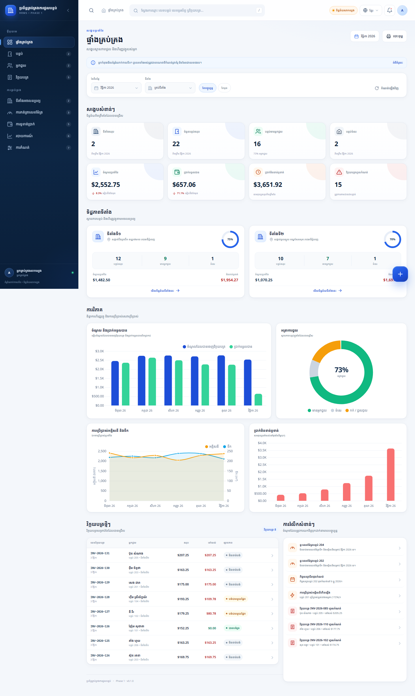
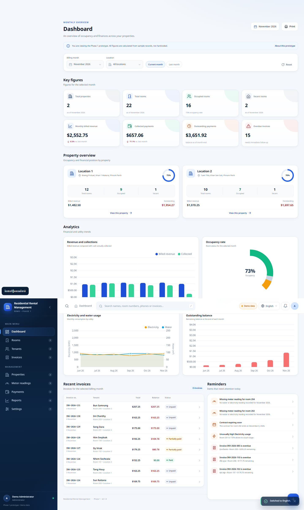
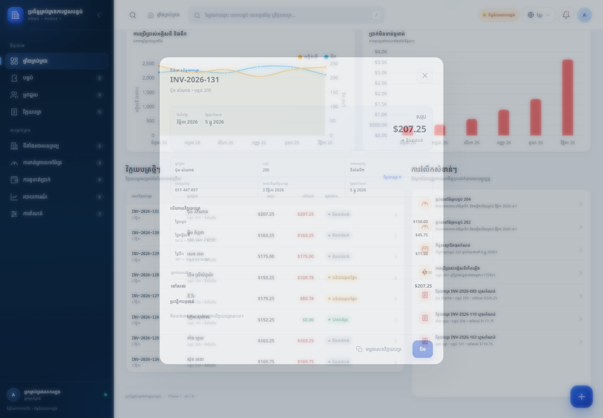
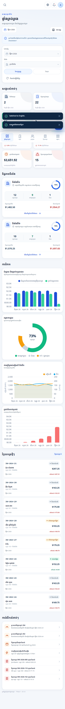

# RRMS — Residential Rental Management System

**Phase 1 prototype** · Khmer-first bilingual interface · PostgreSQL / Supabase-ready schema

RRMS is a rental-management prototype for small residential landlords in Cambodia. The
entire visible interface defaults to Khmer, with an English option available from the
top bar or the login screen. Phase 1 delivers a working, responsive dashboard backed by
deterministic demo records, plus a production-shaped PostgreSQL schema with row-level
security.



> **Status:** the dashboard runs in demo mode. The database schema and seed files are
> complete and tested, but the browser `Store` is not yet wired to Supabase. That adapter
> is a later-phase integration task. No Supabase credentials are required to review the
> prototype.

---

## Quick start

Requirements: **Node.js 18+** (only for the local preview server; there are no runtime
dependencies).

```powershell
npm start
# RRMS preview: http://localhost:8765
```

Open <http://localhost:8765>, then either use the one-click demo button or sign in with:

| Field | Value |
| --- | --- |
| Email | `admin@rrms.local` |
| Password | `rrms2026` |

You can also open `login.html` directly from disk. All scripts are classic IIFEs, so the
prototype works over `file://` as well as a static host.

The session lasts 12 hours. Language, session and sidebar preferences are stored in
`localStorage` under `rrms.lang`, `rrms.session` and `rrms.sidebar.collapsed`.

---

## What Phase 1 includes

### Dashboard

- **Eight live KPI cards** — properties, rooms, occupied rooms, vacant rooms, monthly
  billed revenue, collected payments, outstanding balance and overdue invoices. Every
  figure is derived from the invoice, payment and tenancy records; nothing is hardcoded.
- **Property cards** for each location with occupancy, rent roll and outstanding balance.
- **Four Chart.js charts** — 12-month revenue vs. collections, occupancy doughnut,
  electricity/water consumption and the 12-month outstanding-balance trend.
- **Month and property filters**, quick “current month / last month” chips and reset.
- **Recent invoices table** with status, balance and a full invoice modal (line items,
  meter readings, payment history).
- **Tenant and room detail modals**, reachable from property cards and search results.
- **Global search** (`/` to focus) across rooms, tenants and invoices; supports prefixes
  such as `បន្ទប់ 201` / `room 201`, phone numbers and invoice numbers.
- **Notifications and reminders** — missing readings, overdue invoices, high electricity
  usage and expiring contracts.
- **Khmer / English switch**, persisted between visits.
- **Print layout** for a clean paper summary.
- **Responsive shell** — sidebar on desktop, bottom navigation on mobile, stacked cards,
  mobile invoice cards instead of a wide table, and bottom-sheet modals.
- **No dead buttons.** Modules that are not part of Phase 1 open a roadmap modal that
  explains which phase will deliver them.

### Data and documentation

- Deterministic 12-month demo dataset (`js/demo-data.js`, seed `20261112`).
- Single data-access boundary in `js/store.js` for later Supabase integration.
- Centralized km/en dictionary with **309 keys** (`js/translations.js`).
- PostgreSQL schema: **17 tables, 19 enums, 10 views, 47 RLS policies, 30 triggers**.
- Base seed and optional 12-month demo history generator.
- Architecture, ERD, operations and QA documentation.

---

## Screens

| Khmer dashboard | English dashboard |
| --- | --- |
|  |  |

| Invoice detail | Mobile |
| --- | --- |
|  |  |

---

## Demo dataset

The browser dataset is generated at load time relative to **today**, so the dashboard
always has a current month, recent invoices and future contract expiry dates.

- 2 locations, 22 rooms, 16 active tenancies and 44 individual meters.
- 12 months of readings, invoices and payments.
- Current month: 14 of 16 occupied rooms have invoices.
- Intentional operational alerts:
  - Room 1-204 and room 2-202 have **no current-month reading**.
  - Room 1-201 has a **3× electricity spike**.
  - Tenancy TN-006 **expires in 24 days**.
- Room states: 16 occupied, 2 vacant, 2 reserved, 2 maintenance.
- Payment methods: cash, ABA, ACLEDA, bank transfer and other.
- Invoice states: finalized, partially paid and paid; older invoices may be overdue.

The SQL demo generator is separate and deterministic as well. It creates **139 invoices,
124 payments, 278 readings, 96 expense lines, 4 maintenance requests and 6 notifications**
on top of the base seed. See [Database](#database).

### Resetting local UI state

The dashboard rebuilds demo records on every page load. To reset only preferences:

```js
localStorage.removeItem('rrms.lang');
localStorage.removeItem('rrms.session');
localStorage.removeItem('rrms.sidebar.collapsed');
```

---

## Project structure

```text
.
├── index.html                  # Redirects to login or dashboard
├── login.html                 # Khmer-first sign-in / demo entry
├── pages/
│   └── dashboard.html         # Phase 1 dashboard shell and sections
├── js/
│   ├── config.js              # Demo mode, Supabase placeholders, app constants
│   ├── auth.js                # Demo session + Supabase Auth adapter
│   ├── translations.js        # Centralized km/en dictionary (309 keys)
│   ├── i18n.js                # Translation runtime and DOM binding
│   ├── format.js              # Money, dates, periods, Khmer numerals
│   ├── demo-data.js           # Deterministic 12-month demo generator
│   ├── store.js               # Domain queries and aggregations (data boundary)
│   ├── dashboard.js           # Dashboard rendering, charts, filters, modals
│   ├── app.js                 # Shell, search, notifications, language, roadmap
│   ├── ui.js                  # Modals, toasts, popovers, focus handling
│   ├── icons.js               # Inline SVG icon set
│   └── login.js               # Login page controller
├── css/
│   ├── khmer-fonts.css        # Self-hosted Noto Sans Khmer @font-face
│   ├── main.css               # Tokens, app shell, sidebar, top bar
│   ├── components.css         # Cards, buttons, modals, toasts, forms
│   ├── dashboard.css          # KPIs, charts, tables, reminders, detail views
│   └── mobile.css             # Responsive shell, mobile cards, print rules
├── assets/
│   ├── favicon.svg
│   ├── fonts/NotoSansKhmer/   # Self-hosted woff2 (Khmer + Latin)
│   └── vendor/chart.umd.min.js
├── database/
│   ├── schema.sql             # PostgreSQL 15+ / Supabase schema
│   ├── seed.sql               # Settings, locations, rooms, tenants, meters, rates
│   ├── seed_demo.sql          # Optional 12-month financial history
│   └── local_bootstrap.sql    # Local PGlite/Postgres auth stub (not for Supabase)
├── tests/
│   ├── store.test.js          # 121 assertions for demo data and Store math
│   └── database/              # PGlite schema, trigger and RLS tests
├── docs/
│   ├── ARCHITECTURE.md
│   ├── ERD.md
│   ├── OPERATIONS.md
│   ├── QA.md
│   └── screenshots/
└── scripts/
    └── serve.js               # Zero-dependency static server
```

---

## Database

The schema targets **PostgreSQL 15+** and is written for Supabase. It creates:

- 17 core tables: `profiles`, `locations`, `rooms`, `tenants`, `tenancies`, `meters`,
  `meter_readings`, `utility_rates`, `invoices`, `invoice_items`, `payments`,
  `payment_allocations`, `expenses`, `maintenance_requests`, `notifications`, `settings`,
  `audit_logs`.
- 10 reporting views, all `security_invoker` so RLS applies through them.
- 47 row-level-security policies scoped by role and location.
- Document-number sequences, invoice line-item rollups, payment-allocation ledger,
  immutability guards, audit triggers and four application RPCs.

### Apply in Supabase

Run these in the Supabase SQL editor, in order:

1. `database/schema.sql`
2. `database/seed.sql`
3. `database/seed_demo.sql` *(optional demo history)*

Then create the first user through **Authentication → Users**, and promote the profile:

```sql
update public.profiles
set role = 'admin',
    full_name = 'Property Admin'
where id = '<auth-user-uuid>';
```

`database/local_bootstrap.sql` is **only** for local PostgreSQL/PGlite validation. It
creates a stub `auth` schema and the `anon` / `authenticated` / `service_role` roles, so do
not run it in a real Supabase project.

The frontend `Store` still reads the in-browser dataset. Configuring
`js/config.js` with a Supabase URL and anon key prepares authentication, but live data
binding is deferred to the integration phase. The schema, views and RPCs are the contract
for that adapter.

Key database rules:

- Invoices are created as **draft**, receive line items, then are finalized. Finalized
  financial fields are immutable.
- Payments are allocated to one or more invoices through `payment_allocations`. Invoice
  paid/partial status is derived by trigger from allocations.
- Corrections use **void and re-issue**, never edits to posted history. Voiding requires a
  reason and zero remaining allocations.
- Confirmed meter readings cannot be edited or deleted; void and re-enter.
- Every invoice and payment change is written to `audit_logs`.
- Staff roles are `admin`, `manager`, `accountant`, `viewer`; a tenant account can only
  read its own tenancy, invoices, payments, readings and notifications.

Full detail: [ARCHITECTURE.md](docs/ARCHITECTURE.md) · [ERD.md](docs/ERD.md) ·
[OPERATIONS.md](docs/OPERATIONS.md).

---

## Testing

```powershell
npm test          # Store and demo-data assertions
npm run test:db   # Schema, trigger, RLS and demo-generator checks (needs npm install)
npm run test:all  # Both suites
```

The database tests use `@electric-sql/pglite`, a WASM PostgreSQL build, so no local
PostgreSQL server is needed. They load `local_bootstrap.sql`, `schema.sql`, `seed.sql`
and `seed_demo.sql`, then exercise:

- invoice draft → finalize → partial payment → paid;
- overpayment, mutation and deletion guards;
- allocation removal and void rules;
- confirmed-reading immutability;
- RLS visibility for an admin and a tenant;
- dashboard summary and reporting views;
- demo-generator counts and idempotence.

The UI was smoke-tested in headless Chrome at 360, 390, 768, 1024 and 1440 px, in both
languages, with no console errors. See [QA.md](docs/QA.md).

---

## Phase roadmap

| Phase | Scope | Status |
| --- | --- | --- |
| 1 | Architecture, ERD, schema, Khmer dashboard prototype, translations | **Delivered** |
| 2 | Locations, rooms and tenant management | Planned |
| 3 | Meter readings and utility rates | Planned |
| 4 | Billing engine and invoice generation | Planned |
| 5 | Invoice/payment workflows and receipts | Planned |
| 6 | Reports, exports and analytics | Planned |
| 7 | Settings, roles, audit review and production hardening | Planned |

Unbuilt modules show a phase badge instead of pretending to work.

---

## Known limitations

- Demo authentication is local-only and **not** a security boundary. Production auth and
  RLS live in Supabase.
- The dashboard uses generated browser records; Supabase data binding is not wired yet.
- USD is the only posting currency; KHR is display-only at a configurable rate.
- One active tenancy per tenant and per room is enforced in Phase 1.
- Shared/master meters exist in the schema but shared-cost allocation is not implemented.
- No SMS/Telegram delivery, file uploads, Khmer PDF engine or scheduled jobs yet.
  Printing uses the browser print dialog.
- Invoice edits after finalization are intentionally impossible; corrections require
  voiding.

---

## Assets and licences

- **Noto Sans Khmer** — self-hosted woff2, SIL Open Font License.
- **Chart.js 4.4.7** — self-hosted UMD build, MIT License.
- Icons are inline SVGs authored for this project.

No customer data, credentials or financial records are included in this repository.
