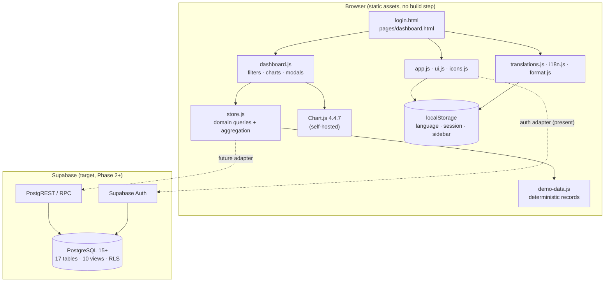
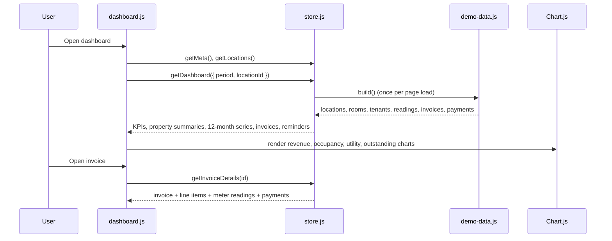
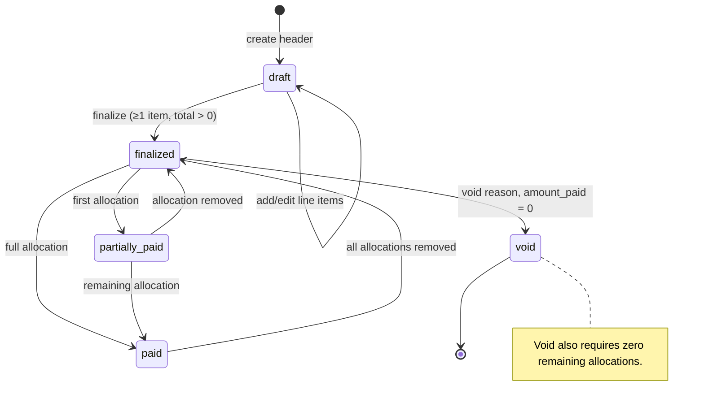
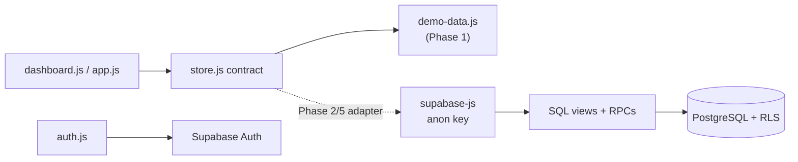

# Architecture

RRMS is deliberately split into two deliverables that can evolve independently:

1. a **static, offline-capable Khmer-first dashboard** that runs today; and
2. a **PostgreSQL/Supabase schema** that defines the durable data model, security and
   financial rules for later phases.

The browser currently reads deterministic demo records. The schema is not yet wired to the
dashboard; the `Store` module is the seam where that integration will happen.

---

## 1. System context



Runtime rules:

- **No build step.** Scripts are classic IIFEs loaded in dependency order. The app works
  from `file://`, a static host, or the included Node preview server.
- **No runtime CDN dependency.** Noto Sans Khmer and Chart.js are self-hosted.
- **No secret in the browser.** Only a Supabase anon key would ever be configured; the
  service-role key must stay server-side.

---

## 2. Frontend layers

| Layer | Files | Responsibility |
| --- | --- | --- |
| Pages | `index.html`, `login.html`, `pages/dashboard.html` | Semantic shells, stable element IDs, accessible labels |
| Configuration | `js/config.js` | Demo mode, language defaults, currency, storage keys, Supabase placeholders |
| Presentation shell | `js/app.js`, `js/ui.js`, `js/icons.js` | Sidebar/top bar, search, notifications, modals, toasts, roadmap dialogs |
| Localization | `js/translations.js`, `js/i18n.js`, `js/format.js` | Central dictionary, DOM binding, language state, money/date/period formats |
| Dashboard | `js/dashboard.js` | Filters, KPIs, property cards, four charts, invoice table, reminders, detail views |
| Domain/data | `js/store.js` | Joins, totals, balances, occupancy, search, reminder derivation |
| Demo source | `js/demo-data.js` | Seeded 12-month record generator (seed `20261112`) |
| Auth | `js/auth.js` | Demo session (12 h) and optional Supabase Auth adapter |
| Styling | `css/*.css` | Design tokens, shell, components, dashboard, responsive and print rules |

### Data flow: dashboard render



Every number on the page is calculated from records in `Store`. The dashboard does not
contain hardcoded totals. Changing the month or location re-runs the aggregation.

### Public Store contract

`RRMS.Store` exposes a small read-only API. A future Supabase adapter must preserve this
shape so `dashboard.js` and `app.js` do not change:

```text
getMeta()                     getLocations()          getLocation(id)
getRooms()                    getRoom(id)             getTenants()
getTenant(id)                 getTenancies()          getInvoices()
getInvoice(id)                getInvoiceByNumber(n)   getInvoiceDetails(id)
getPayments()                 getPaymentsForInvoice() getMeters()
getReadings()                 getSettings()           getPeriods()
monthOptions()                getDashboard(filters)   getNotifications()
getTenantDetails(id)          getRoomDetails(id)      getOpenInvoicesForTenant(id)
tenancyForRoom(id)            displayStatus(invoice)  search(query)
```

### Responsive behaviour

- Desktop (≥ 901 px): fixed sidebar, top bar, 12-column-ish dashboard grid.
- Tablet and mobile (≤ 900 px): the sidebar is replaced by a five-item bottom navigation,
  search becomes an overlay, the invoice table becomes a card list, and detail modals
  become bottom sheets. Summaries stay two-column at 768 px and narrow phones.
- Phone (≤ 560 px): tighter spacing, icon-only language control and compact top-bar
  actions.
- Print: navigation, filters and action buttons are hidden; summary, property and invoice
  content remain.
- The layout was verified at 360, 390, 768, 1024 and 1440 px with no horizontal overflow.

---

## 3. Bilingual design

The **default and fallback language is Khmer**. English is a secondary option.

- `js/translations.js` is the single dictionary: **309 keys**, each with `km` and `en`.
- `data-i18n`, `data-i18n-placeholder`, `data-i18n-title` and `data-i18n-aria-label`
  bind static markup to keys.
- `I18n.t(key, params)` supports `{name}` interpolation; missing keys are logged and
  fall back to the key, while missing English falls back to Khmer.
- `I18n.apply()` updates text and attributes, sets `<html lang>` and `data-lang`, then the
  page re-renders dynamic sections on the `rrms:language` event.
- `Format` uses Western digits with Khmer month/day names and `$` / `៛` symbols. This is
  common on Cambodian rental invoices and avoids digit-conversion ambiguity in accounting.
- Database records carry `name_km` / `name_en`, `address_km` / `address_en`,
  `title_km` / `title_en`, etc., so user-entered data stays bilingual too.
- Language choice persists in `localStorage` (`rrms.lang`); it is a UI preference, not a
  security control.

Adding a key is a one-file change. Adding a third language would require extending the
dictionary shape and `Config.languages`; Phase 1 intentionally supports two.

---

## 4. Domain model and financial rules

### Core chain

```text
Location → Room → Tenancy → Tenant
                 ├── Meters → Meter readings
                 └── Invoices → Invoice items
                              ↑
                    Payment allocations ← Payments
```

`invoices` stores tenant/room/tenancy/location snapshots by reference plus billing period
and dates. `invoice_items` is the source of truth for the amount breakdown.

### Invoice lifecycle



Rules enforced in the database:

- Header totals (`rent_amount`, `electricity_amount`, `water_amount`, `other_charges`,
  `discount_amount`, `late_fee`) are recalculated from line items while the invoice is a
  draft. `total_amount` is a stored generated column, so it cannot drift from its parts.
- `previous_balance` is added to the current invoice total and is not a line item.
- Finalization requires at least one item, a positive total and zero payments.
- After finalization, all financial and identity fields are immutable. Only
  `amount_paid`, `notes` and lifecycle status may change.
- `amount_paid` can only be changed by the payment-allocation trigger
  (`rrms.allocation_write` guard). Direct edits are rejected.
- Status is derived from paid amount: `finalized` (0), `partially_paid` (between),
  `paid` (total). A void requires a reason and zero allocations.
- Deleting invoices is limited to drafts. Finalized documents are never deleted.

### Payments

- A payment belongs to a tenant and location; it is not tied to one invoice.
- `payment_allocations` is a many-to-many ledger between payments and invoices.
- Allocation insert validates: completed payment, finalized/unpaid invoice, matching
  tenant and location, same currency, allocation ≤ invoice balance, and total allocations
  ≤ payment amount.
- Allocations are immutable. A correction deletes the allocation (which reopens the
  invoice), then voids the payment with a reason.
- Payment and allocation changes are audited.

### Meter readings

- One reading per meter per month (`meter_id`, `period_start`).
- `consumption` is a stored generated column (`current − previous`).
- `amount` is set by trigger from `consumption × rate`.
- Readings are entered as `draft`, then `confirmed`. Confirmed readings cannot be edited
  or deleted; void and re-enter.

### Document numbers

Global sequences produce collision-free numbers, prefixed by document year:

```text
INV-2026-0001   PAY-2026-0001   EXP-2026-0001   MNT-2026-0001
```

The year comes from the document date (`issue_date` / `payment_date` / `expense_date`);
maintenance uses the current year. Numbers are unique, readable and independent of UUID
primary keys.

---

## 5. Security model

### Identity and roles

Supabase Auth owns `auth.users`. A trigger creates a `profiles` row for every new user
with the read-only `viewer` role. Roles:

| Role | Intent |
| --- | --- |
| `admin` | Full access, role management, settings, audit |
| `manager` | Rooms, tenants, tenancies, meters, maintenance; scoped to location |
| `accountant` | Readings, invoices, payments, expenses; scoped to location |
| `viewer` | Read-only staff access; scoped to location |
| `tenant` | Own tenancy, invoices, payments, readings and notifications only |

A staff profile may have `location_id = NULL`, meaning “all locations”. Otherwise it is
scoped to one location. A tenant profile must reference a `tenant_id` (enforced by check
constraint).

### RLS matrix

RLS is enabled on **all 17 tables**. Views use `security_invoker = true`.

| Table group | Admin | Manager | Accountant | Viewer | Tenant |
| --- | --- | --- | --- | --- | --- |
| Locations | RW | RW (own) | R | R | own location |
| Rooms | RW | RW (own) | R | R | own room |
| Tenants | RW | RW | R | R | self |
| Tenancies | RW | RW (own) | R | R | own |
| Meters / rates | RW | RW (own) | R | R | own room meters |
| Readings | RW | RW (own) | RW (own) | R | own |
| Invoices / items | RW | RW (own) | RW (own) | R | own |
| Payments / allocations | RW | RW (own) | RW (own) | R | own |
| Expenses | RW | RW (own) | RW (own) | R | — |
| Maintenance | RW | RW (own) | R | R | own reports |
| Notifications | RW | RW (own) | own | own | own / broadcast |
| Settings | RW | R | R | R | — |
| Audit logs | R | — | — | — | — |

“Own” means `location_id` matches the profile scope. Tenant access is expressed through
`tenant_id = rrms_tenant()` or an active/upcoming tenancy for a location or room.

### Defense in depth

- Helper functions (`rrms_role`, `rrms_location`, `rrms_tenant`, `rrms_can_*`,
  `rrms_tenant_*`) are `security definer` with a pinned `search_path`, so policies do not
  recurse through RLS-protected tables.
- `anon` has no table privileges. `authenticated` receives explicit table/sequence grants.
- Function execution is revoked from `PUBLIC` and granted only where required, so the RPC
  surface is deliberate.
- `profiles` updates are protected by a trigger: non-admins cannot change their own role,
  location, tenant link or active flag.
- Audit triggers run as the table owner so clients cannot suppress or forge log rows.
- `service_role` is never used by the browser.

### RPC surface

| Function | Purpose |
| --- | --- |
| `finalize_invoice(uuid)` | Draft → finalized with all guard checks |
| `void_invoice(uuid, text)` | Void with a required reason |
| `record_payment(uuid, numeric, method, text, date, text)` | Create payment + allocation atomically |
| `dashboard_summary(date, uuid)` | JSON month summary for the future adapter |

All are `security invoker`, so caller RLS still applies.

---

## 6. Database structure

- **17 tables**, **19 enums**, **10 views**, **47 policies**, **30 triggers**, 4 sequences.
- No PostgreSQL extensions beyond built-ins (`gen_random_uuid()` is core in PG13+), which
  keeps PGlite validation and Supabase deployment simple.
- Money: `numeric(12,2)`; rates: `numeric(12,4)`. No floating point for financial data.
- Dates: `date` for business dates; `timestamptz` for audit/system timestamps.
- Bilingual text columns default to empty strings, not null, simplifying inserts.
- Partial unique indexes enforce one active tenancy per room and per tenant, and one
  active meter per room/utility.
- Search indexes cover invoice period/location/status, tenant, room, outstanding invoices,
  readings, tenancies, expenses, maintenance and notifications.
- The `updated_at` convention is maintained by trigger.

See [ERD.md](ERD.md) for the entity diagram and table dictionary.

### Reporting views

| View | Use |
| --- | --- |
| `v_room_occupancy` | Room list with current tenant and rent |
| `v_tenancy_overview` | Tenant/room/location join plus days until expiry |
| `v_invoice_ledger` | Invoice totals, balance, display status, overdue flag |
| `v_monthly_financials` | Billed/collected/outstanding/expenses/net by month/location |
| `v_location_snapshot` | Occupancy and rent roll per property |
| `v_latest_readings` | Latest non-void reading per meter |
| `v_expiring_tenancies` | Active contracts ending within 60 days |
| `v_tenant_balances` | Lifetime billed/paid/outstanding per tenant |
| `v_open_maintenance` | Open/in-progress work with assignee |
| `v_utility_rates_current` | Effective rate per location and utility |

---

## 7. Integration path



Planned steps:

1. Add a `js/supabase-store.js` that implements the existing Store methods using
   `supabase-js`, views and RPCs.
2. Switch `Store` selection in `config.js` based on `isSupabaseConfigured()`.
3. Replace demo session claims with profile data from `profiles` (role, location, tenant).
4. Add write screens phase by phase; all writes go through RPCs where money is involved.
5. Add realtime notifications only if needed; polling is sufficient for Phase 1 scale.

The adapter must not bypass RLS or embed a service-role key. Column names in the views are
already shaped for the dashboard (names, room number, balance, display status).

---

## 8. Key decisions and trade-offs

| Decision | Why | Cost |
| --- | --- | --- |
| Demo dataset in the browser | Reviewable offline, deterministic, no credentials | Not live data; adapter still required |
| Classic IIFEs, no bundler | Works from `file://`, zero toolchain | Manual script ordering; no tree-shaking |
| Khmer default, English secondary | Matches primary users | Every new string must be added twice |
| `km`/`en` columns in tables | Simple queries, no join for two languages | Adding languages needs schema work |
| `numeric(12,2)` money | Exact accounting arithmetic | Slightly slower than integers |
| Invoice items as source of truth | Consistent printed breakdown | Header writes must go through items |
| Immutable posted invoices | Auditability, trust | Corrections require void/re-issue |
| Payment allocation ledger | One payment can cover several invoices | More complex than `invoice_id` on payment |
| Partial unique indexes for tenancies | DB-level prevention of double occupancy | No historical overlap support yet |
| RLS helpers as security definer | Avoid recursive policies, central logic | Must keep `search_path` pinned |

---

## 9. Phase boundaries

Phase 1 deliberately stops at a read-only dashboard plus schema. Screens for rooms,
tenants, readings, billing, payments, reports and settings are represented by navigation
entries with phase badges and a roadmap dialog. Adding a screen means implementing its
Store methods and write RPCs, not changing the shell architecture.

See [OPERATIONS.md](OPERATIONS.md) for deployment and [QA.md](QA.md) for verification.
