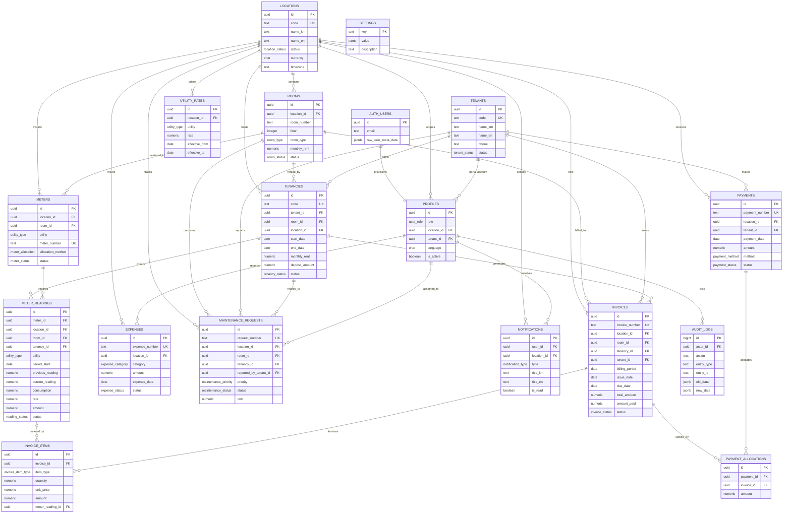

# Entity Relationship Diagram

The diagram below reflects `database/schema.sql`. `AUTH_USERS` is owned by Supabase Auth;
the other 17 entities are in the `public` schema.



---

## Table dictionary

| Table | Purpose | Key rules |
| --- | --- | --- |
| `profiles` | Application identity and role | 1:1 with `auth.users`; tenant role requires `tenant_id`; staff `location_id` may be null (all locations) |
| `locations` | A rental property/building | Unique lowercase code; soft state `active` / `inactive` |
| `rooms` | Rentable unit | Unique `(location_id, room_number)`; status drives occupancy |
| `tenants` | Person or household | Unique code; optional email/ID/emergency contact |
| `tenancies` | Contract linking tenant and room | Partial unique indexes: one active per room and per tenant |
| `meters` | Electricity/water meter | Unique meter number; one active meter per room+utility |
| `utility_rates` | Effective-dated price per utility | No overlapping periods per location+utility (trigger) |
| `meter_readings` | Monthly meter snapshot | Unique `(meter_id, period_start)` among non-void rows; `consumption` generated; `amount` trigger-set |
| `invoices` | Billing document | Unique number; unique `(tenancy_id, billing_period)` among non-void rows; totals generated; immutable after finalization |
| `invoice_items` | Printed breakdown / source of truth | Roll up to invoice category totals while draft; locked after finalization |
| `payments` | Money received | Unique number; amount > 0; immutable except void, and void requires no allocations |
| `payment_allocations` | Payment ↔ invoice ledger | Unique pair; total ≤ payment amount; allocation ≤ invoice balance; immutable |
| `expenses` | Operating costs | Unique number; location nullable for company-wide costs; void keeps history |
| `maintenance_requests` | Work orders | Number assigned automatically; priority/status enums; optional assignee |
| `notifications` | In-app alerts | Per-user or broadcast (null user, optional location); read timestamp consistency |
| `settings` | Application configuration | JSONB key/value; keys match `[a-z][a-z0-9_.]`; admin write |
| `audit_logs` | Immutable financial audit trail | Append-only via security-definer trigger; admin read only |

---

## Money and status rules

### Invoice total

`total_amount` is a **stored generated column**:

```text
total_amount =
    rent_amount
  + electricity_amount
  + water_amount
  + other_charges
  + late_fee
  - discount_amount
  + previous_balance
```

`balance_due` is not stored; it is `total_amount - amount_paid` in `v_invoice_ledger`.
This avoids a second source of truth for a value that changes with every payment.

### Invoice status

| Stored status | Meaning |
| --- | --- |
| `draft` | Editable; may have line items; cannot receive payments |
| `finalized` | Posted, unpaid |
| `partially_paid` | At least one allocation, balance remains |
| `paid` | Allocations equal total |
| `void` | Cancelled with reason; zero allocations; immutable |

“Overdue” and “partial” are **display statuses** in `v_invoice_ledger`, derived from dates
and balances. They are not stored, so no nightly job is required to keep them current.

### Payment flow

```text
payments (tenant + location + amount)
        │
        └── payment_allocations (payment_id, invoice_id, amount)
                    │
                    └── trigger recalculates invoices.amount_paid and status
```

A payment can cover several invoices. Allocations are deleted to unapply money; the
invoice reopens automatically. A payment is voided only after its allocations are gone.

### Meter reading flow

```text
meters (room, utility, number)
      │
      └── meter_readings (period, previous, current)
                │
                ├── consumption = current − previous   (generated)
                └── amount      = consumption × rate   (trigger)
```

Readings may be attached to an invoice item through `invoice_items.meter_reading_id`, so a
printed invoice can show the exact readings behind an electricity or water charge.

---

## Enum reference

| Enum | Values |
| --- | --- |
| `user_role` | admin, manager, accountant, viewer, tenant |
| `location_status` | active, inactive |
| `room_type` | standard, large, small, studio, other |
| `room_status` | vacant, occupied, reserved, maintenance, inactive |
| `tenant_status` | active, inactive, blacklisted |
| `tenancy_status` | upcoming, active, ended, cancelled |
| `utility_type` | electricity, water |
| `meter_status` | active, inactive, replaced |
| `meter_allocation` | individual, shared, master |
| `reading_status` | draft, confirmed, void |
| `invoice_status` | draft, finalized, partially_paid, paid, void |
| `invoice_item_type` | rent, electricity, water, other, discount, late_fee, adjustment |
| `payment_method` | cash, aba, acleda, bank_transfer, other |
| `payment_status` | completed, void |
| `expense_category` | utilities, repairs, supplies, salaries, taxes, other |
| `expense_status` | recorded, void |
| `maintenance_priority` | low, medium, high, urgent |
| `maintenance_status` | open, in_progress, resolved, cancelled |
| `notification_type` | missing_reading, invoice_due, invoice_overdue, contract_expiring, payment_received, high_usage, maintenance, system |

---

## Indexes with business meaning

| Index / constraint | Protects |
| --- | --- |
| `tenancies_one_active_per_room_idx` | A room cannot be double-rented |
| `tenancies_one_active_per_tenant_idx` | One active contract per tenant in Phase 1 |
| `meters_active_room_utility_idx` | One active meter per utility per room |
| `meter_readings_meter_period_live_idx` | One live monthly reading per meter; voided rows allow correction |
| `invoices_tenancy_period_live_idx` | One live bill per contract/month; voided rows allow re-issue |
| `utility_rates_period_unique` + overlap trigger | No ambiguous utility price |
| `payment_allocations_unique` | A payment cannot be allocated twice to one invoice |
| `invoices_paid_within_total` | Paid amount cannot exceed total |
| `invoice_items_amount_sign` | Discounts positive; only adjustments may be negative |

---

## Reporting views

| View | Rows | Grain |
| --- | --- | --- |
| `v_room_occupancy` | Rooms | One row per room, current active tenant |
| `v_tenancy_overview` | Tenancies | Tenant, room, location, days to expiry |
| `v_invoice_ledger` | Invoices | Header totals, balance, display status, overdue flag |
| `v_monthly_financials` | Month × location | Billed, collected, outstanding, expenses, net |
| `v_location_snapshot` | Locations | Room counts by status, rent roll, outstanding |
| `v_latest_readings` | Meters | Latest non-void reading |
| `v_expiring_tenancies` | Tenancies | Active contracts ending within 60 days |
| `v_tenant_balances` | Tenants | Lifetime billed/paid/outstanding |
| `v_open_maintenance` | Requests | Open/in-progress with assignee |
| `v_utility_rates_current` | Location × utility | Effective rate today |

All views are `security_invoker = true`; a tenant querying `v_invoice_ledger` sees only
their own rows, and a location-scoped manager sees only their property.

---

## Seed relationship map

`seed.sql` creates:

- 2 locations (`loc-1`, `loc-2`);
- 22 rooms (12 + 10), with 16 occupied, 2 vacant, 2 reserved, 2 maintenance;
- 16 tenants and 16 active tenancies;
- 44 individual meters (electricity + water per room);
- 4 effective-dated utility rates;
- 11 settings.

`seed_demo.sql` adds the 12-month history. See [OPERATIONS.md](OPERATIONS.md) for rebuild
instructions.
